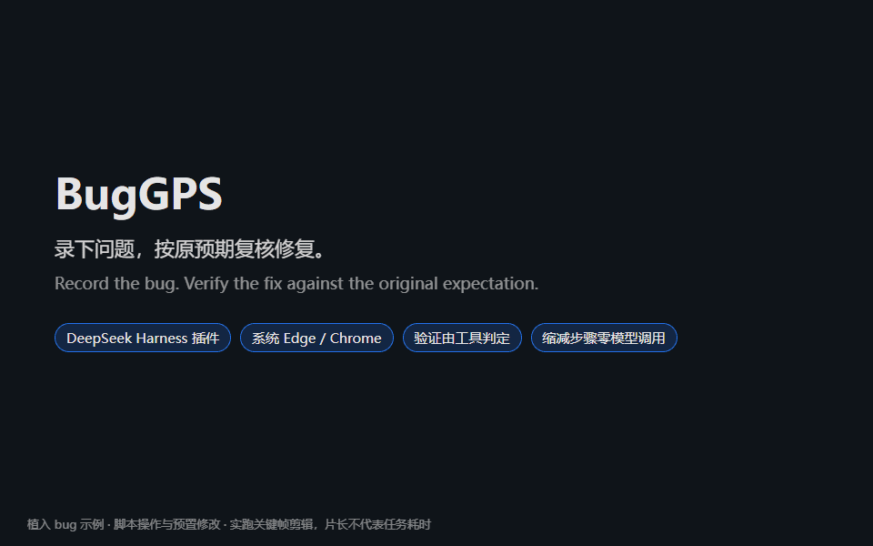

# BugGPS · dsh-bug-gps

[简体中文](../../README.md) · [English](README.en.md) · [日本語](README.ja.md) · [한국어](README.ko.md) · [Deutsch](README.de.md) · [Français](README.fr.md) · [Español](README.es.md) · [Português (Brasil)](README.pt-BR.md)

**Fehler aufzeichnen. Die Korrektur am ursprünglichen Sollverhalten prüfen.**

BugGPS ist ein Plugin für DeepSeek Harness (DSH). Es richtet sich an bereits entdeckte Browserfehler: Aktionen und erwartetes Ergebnis erfassen, einen wiederholbaren Fehler festhalten und den geänderten Code mit denselben Prüfungen und einer unabhängigen Ausgangsversion verifizieren.

> Vorabversion. Das npm-Paket ist noch nicht veröffentlicht. Die Installation verwendet einen lokalen Quellcode-Checkout. Die Kompatibilität ist derzeit auf DSH **0.2.1-rc.5** begrenzt.

[Installation und Entfernen (Chinesisch/Englisch)](../installation.md) · [Versionsbezogene Prüfungen](../verification/1.0.0/README.md).



Die Demo steuert das mitgelieferte Beispiel mit eingebautem Fehler per Skript und wendet vorbereitete Änderungen an. Seiten und Werkzeugausgaben stammen aus echten Durchläufen; ausgewählte Bilder wurden geschnitten. Die Videolänge entspricht keiner gemessenen Laufzeit. Ergebniskarten, Mauszeiger und Untertitel sind Präsentationselemente.

## Das Beispiel ausprobieren

Benötigt Node.js ≥20, Git sowie Microsoft Edge oder Google Chrome. Die dokumentierten Windows-Prüfungen verwenden Node 24.22.0 und Edge 156. Andere Browser und Betriebssysteme sind damit nicht abgedeckt.

```bash
git clone --branch release/v1.0.0-preparation --single-branch https://github.com/lijiaqi-AI-Product-Manager/dsh-bug-gps.git
cd dsh-bug-gps
npm ci
node bin/buggps.js demo ../buggps-demo
node bin/buggps.js doctor --repo ../buggps-demo
```

`demo` erstellt ein separates Git-Repository und zeigt die nächsten Schritte. Den Entwicklungsserver starten, das Projekt in DSH öffnen und Fehler sowie Sollverhalten aufzeichnen. `doctor` prüft Laufzeit, Browser, Befehle, Konfiguration und Port. Vorhandene Entwürfe lassen sich ohne erneute interaktive Aufnahme festschreiben.

## Das Plugin in DSH laden

Für `dsh plugin` muss außerdem **pnpm ≥10** im PATH verfügbar sein.

```bash
dsh plugin --profile PROFILE add "/absolute/path/to/dsh-bug-gps"
dsh --profile PROFILE --dump-config
```

`PROFILE` durch das tatsächlich verwendete Profil und den Pfad durch den absoluten Checkout-Pfad ersetzen. Die betreffende DSH-Instanz neu starten und im Zielprojekt `buggps_status` aufrufen. Ein Konfigurationseintrag allein belegt keine erfolgreiche Werkzeugregistrierung.

Desktop und CLI können unterschiedliche Profile verwenden. Eine Installation in `web` bestätigt keine Desktop-Installation. Vor der Nutzung der Pluginverwaltung die eingebettete DSH-Version und das tatsächliche Profil prüfen. Der offizielle rc.5-CLI-Ablauf wurde ausgeführt; der Desktop-Installationsweg hat noch keine separate Abnahme durchlaufen.

## Ablauf

1. **Aufzeichnen:** Aktionen, Browsereinstellungen und ausdrückliche Erwartungen speichern. Optionale Prüfpunkte halten Zwischenzustände fest; markierte Schlüsselschritte bleiben bei der Kürzung erhalten.
2. **Festschreiben:** Die App mit dem gespeicherten `serve`-Befehl starten und denselben Fehler standardmäßig dreimal reproduzieren.
3. **Korrigieren:** DSH bearbeitet den Anwendungscode mit der vorhandenen Konfiguration.
4. **Prüfen:** Die vollständige Aufnahme standardmäßig dreimal unter den ursprünglichen Bedingungen abspielen. Für `VERIFIED` muss auch eine unabhängige Ausgangsversion den festgehaltenen Fehler erneut zeigen.

## Ergebnisse verstehen

| Ergebnis | Bedeutung |
|---|---|
| `VERIFIED` | Die aufgezeichneten Prüfungen bestehen; eine frische Ausgangsversion reproduziert den Fehler. |
| `PASSED_UNBOUND` | Die Prüfungen bestehen auf einem externen Server, dessen Code nicht an diesen Patch gebunden ist. |
| `NEEDS_REVIEW` | Schwächere Belege erfordern Prüfung: deaktivierter Auslöser, reine Abwesenheitsprüfungen, andere Lokatoren, anderer Prüfer oder fehlgeschlagener Ausgangsvergleich. |
| `STILL_FAILING / DIFFERENT_FAILURE` | Der ursprüngliche Fehler bleibt oder ein anderes Symptom bzw. ein Prüfpunkt schlägt fehl. |
| `TEST_INVALID / ENV_BLOCKED` | Die Testdefinition ist unbrauchbar oder die Umgebung blockiert. Beides ist keine erfolgreiche Reproduktion. |
| `FLAKY / STALE / CASE_TAMPERED` | Unterschiedliche Ergebnisse, Änderungen während der Prüfung oder veränderte festgeschriebene Belege. |
| `NO_CODE_CHANGE` | Unveränderter Ausgangscode. Einen beauftragten Fix fortsetzen; bei reiner Prüfung den unveränderten Stand melden. |
| `BUDGET_EXHAUSTED / ABORTED` | Budget erschöpft oder Aufgabe abgebrochen; die Belege sind unvollständig. |

## Umfang und Grenzen

- Das Ergebnis gilt für das aufgezeichnete Szenario, nicht für die Fehlerfreiheit der gesamten App.
- Unterstützt wird zurücksetzbarer Frontend-Zustand. Ein Aufwärmdurchlauf geht den gezählten Versuchen voraus; Änderungen an Serverdaten sind nicht abgenommen.
- Die Schlussprüfungen laufen standardmäßig 1.000 ms mit einem Zielabstand von 50 ms. Lücken und spätere Änderungen bleiben außerhalb dieser Beobachtung.
- Kürzung liefert einen bestätigten kürzeren Pfad innerhalb eines Budgets. Maßgeblich bleibt die vollständige Aufnahme; globale Minimalität und Kausalität werden nicht zugesichert.
- Snapshots folgen Git und lassen ignorierte Abhängigkeiten und Konfiguration aus. Geteilte Abhängigkeiten und Umgebungsdaten des Ausgangsvergleichs werden separat erfasst. Ein worktree ist keine Sicherheits-Sandbox.
- Als geheim erkannte Eingaben werden als Umgebungsreferenzen gespeichert. Die Erkennung ist unvollständig; Artefakte vor dem Teilen prüfen.
- Definitionen und Belege werden auf Konsistenz geprüft. Shell-Schutz ist begrenzt; Hashwerte sind kein fälschungssicherer Nachweis.

[Konfiguration, alle Ergebnisse und ausführliche Grenzen](../../README.md)

## Belege und Rückmeldungen

Tests, Paketinstallation und der feste Satz aus zwölf historischen Fällen werden getrennt dokumentiert. Die Fälle flossen in Verbesserungen ein und bilden einen erweiterten Regressionstest, keinen blinden Testsatz. Fehlversuche bleiben im Nenner.

[Fallanleitung](../../bench/RECORDING-GUIDE.md) · [Laufprotokolle](../../bench/results) · [Browser-Regressionstests](../../test/counterexamples.test.js) · [Problem melden](https://github.com/lijiaqi-AI-Product-Manager/dsh-bug-gps/issues/new)

DSH-Version, Betriebssystem, Sollverhalten, exaktes Ergebnis und eine sicher teilbare Reproduktion angeben. Zugangsdaten und private Daten entfernen.

Hat BugGPS bei einer Korrektur geholfen, unterstützt ein Star die Auffindbarkeit.

[Host-Abhängigkeiten und Paketkompatibilität](../host-compatibility.md)

MIT · [LICENSE](../../LICENSE)


[Die Korrektur im externen ChartDB-Projekt nachvollziehen](../../bench/repairs/chartdb-dbml-index/README.md) · [DSH rc.5](../../bench/results/account-project-chartdb-dbml-index-2026-11-03.json) · [ChartDB-Beispiel: AGPLv3](../../bench/repairs/chartdb-dbml-index/LICENSE)
