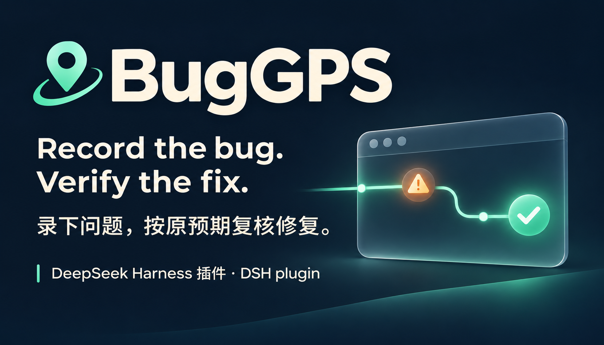
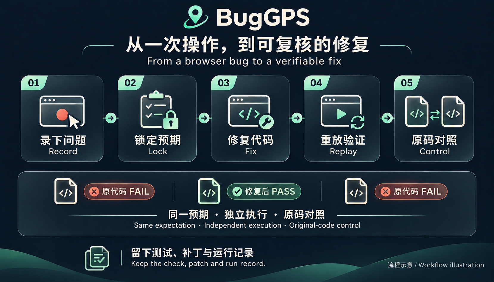

[](https://github.com/lijiaqi-AI-Product-Manager/dsh-bug-gps/releases/latest) [](https://www.npmjs.com/package/dsh-bug-gps) [](https://github.com/lijiaqi-AI-Product-Manager/dsh-bug-gps/actions/workflows/test.yml) [](https://github.com/lijiaqi-AI-Product-Manager/dsh-bug-gps/blob/main/docs/installation.md) [](https://github.com/lijiaqi-AI-Product-Manager/dsh-bug-gps/blob/main/docs/host-compatibility.md) [](https://github.com/lijiaqi-AI-Product-Manager/dsh-bug-gps/blob/main/LICENSE)

[安装 / Install](../installation.md) · [演示 / Demo](../media/buggps-demo.gif) · [运行依据 / Evidence](https://github.com/lijiaqi-AI-Product-Manager/dsh-bug-gps/issues/4)

# BugGPS · dsh-bug-gps

[简体中文](../../README.md) · [English](README.en.md) · [日本語](README.ja.md) · [한국어](README.ko.md) · [Deutsch](README.de.md) · [Français](README.fr.md) · [Español](README.es.md) · [Português (Brasil)](README.pt-BR.md)



**Enregistrez le problème. Vérifiez la correction selon le résultat attendu au départ.**

BugGPS est un plugin pour DeepSeek Harness (DSH), destiné aux problèmes de navigateur déjà identifiés. Il enregistre les actions et le résultat attendu, établit un échec reproductible, puis vérifie le code modifié avec les mêmes contrôles et une version de référence indépendante.

> Installez la version publiée **1.0.0** depuis npm. Compatible avec DSH **0.2.1-rc.5**, `headless` / `web`, sous Windows. Les sources Git et Release fixes figurent dans le [guide d’installation](../installation.md).

```bash
dsh plugin --profile web add dsh-bug-gps@1.0.0
dsh --profile web --dump-config
```

L'exemple utilise `web` ; remplacez-le par `headless` dans les deux commandes pour une instance sans interface. Confirmez la couche de configuration, redémarrez cette instance, puis appelez `buggps_status` dans le projet Git cible. Le bureau nécessite une validation séparée.

[Installation et suppression (chinois/anglais)](../installation.md) · [Résultats historiques (révision fixe)](../verification/1.0.0/README.md). Chaque résultat précise sa source et sa portée ; les vérifications actuelles figurent dans la liste de publication.

Après la mise à jour, recommencez les anciens enregistrements. Le verrouillage vérifie le texte, les valeurs et la visibilité capturés. Les actions dans des cadres intégrés ou d’autres onglets rendent l’enregistrement incomplet.


La démonstration pilote par script l'exemple fourni, qui contient un défaut volontaire, et applique des modifications prédéfinies. Les pages et sorties des outils sont réelles, mais les images clés sont montées : la durée vidéo n'est pas une durée d'exécution mesurée. Les cartes de résultat, le curseur et les sous-titres sont des éléments de présentation.

## Essayer l'exemple fourni

Nécessite Node.js ≥20, Git et Microsoft Edge ou Google Chrome installé. Les contrôles Windows documentés utilisent Node 24.22.0 et Edge 156 ; ils ne couvrent pas tous les navigateurs et systèmes.

```bash
git clone https://github.com/lijiaqi-AI-Product-Manager/dsh-bug-gps.git
cd dsh-bug-gps
git checkout --detach c48aa094b6b32731d517fb0026cceccdae60e117
npm ci
node bin/buggps.js demo ../buggps-demo
node bin/buggps.js doctor --repo ../buggps-demo
```

`demo` crée un dépôt Git distinct et indique les étapes suivantes. Démarrez le serveur de développement, ouvrez le projet dans DSH, puis enregistrez le problème et son résultat attendu. `doctor` vérifie l'environnement, le navigateur, les commandes, la configuration et le port. Un brouillon existant peut être verrouillé sans nouvel enregistrement interactif.

## Charger le plugin dans DSH

Le chargement avec `dsh plugin` nécessite aussi **pnpm ≥10** dans le PATH.

```bash
dsh plugin --profile PROFILE add "/absolute/path/to/dsh-bug-gps"
dsh --profile PROFILE --dump-config
```

Remplacez `PROFILE` par le profil réellement utilisé et le chemin par celui, absolu, des sources. Redémarrez cette instance de DSH et appelez `buggps_status` dans le projet cible. Une entrée de configuration ne prouve pas que les outils sont chargés.

L'application de bureau et la CLI peuvent utiliser des profils différents. Une installation dans `web` ne confirme pas l'installation dans l'application. Vérifiez sa version DSH intégrée et son profil avant d'utiliser son gestionnaire de plugins. Le parcours de la CLI officielle rc.5 a été exécuté ; l'installation de bureau n'a pas encore terminé sa validation distincte.

## Fonctionnement

1. **Enregistrer :** conserver les actions, les paramètres du navigateur et les attentes explicites. Les points de contrôle préservent les états intermédiaires ; les étapes clés restent lors du raccourcissement.
2. **Verrouiller :** démarrer l'application avec la commande `serve` enregistrée et reproduire trois fois par défaut le même échec.
3. **Corriger :** DSH modifie les sources de l'application avec votre configuration existante.
4. **Vérifier :** rejouer trois fois par défaut l'enregistrement complet selon les conditions d'origine. Une version de référence indépendante doit aussi reproduire l'échec verrouillé pour obtenir `VERIFIED`.

## Comprendre le résultat

| Résultat | Signification |
|---|---|
| `VERIFIED` | Les contrôles passent et une nouvelle exécution de la référence reproduit l'échec initial. |
| `PASSED_UNBOUND` | Les contrôles passent sur un serveur externe dont le code ne peut pas être lié au patch. |
| `NEEDS_REVIEW` | Des preuves plus faibles imposent un examen : déclencheur désactivé, contrôles d'absence seuls, autre localisateur, autre évaluateur ou échec initial non reproduit sur la référence. |
| `STILL_FAILING / DIFFERENT_FAILURE` | L'échec initial persiste, ou un autre symptôme ou point de contrôle échoue. |
| `TEST_INVALID / ENV_BLOCKED` | Définition inexploitable ou environnement bloqué ; ce n'est pas une reproduction réussie. |
| `FLAKY / STALE / CASE_TAMPERED` | Résultats incohérents, code modifié pendant la vérification ou preuves verrouillées modifiées. |
| `NO_CODE_CHANGE` | Code inchangé depuis le verrouillage. Poursuivre une correction demandée ; pour une simple vérification, signaler l'absence de changement. |
| `BUDGET_EXHAUSTED / ABORTED` | Budget épuisé ou tâche annulée ; les preuves sont incomplètes. |

`buggps_status` affiche la dernière exécution valide selon son heure de fin. Un résultat historique ne reste applicable que si le code, le cas, les données verrouillées et l’évaluateur correspondent encore ; `not_current_reasons` explique les écarts. `NO_CODE_CHANGE` conserve le sens de code inchangé et ne confirme pas une correction.

Les aperçus textuels sont limités à 12 000 caractères, avec le verdict, les références et la prochaine action en premier. Si `output_preview: abbreviated` apparaît, consultez le brouillon, le cas, le compte rendu ou le patch référencé. Les résultats structurés complets et les contrôles restent inchangés. Ne reconstruisez pas de test et n’appliquez pas de patch à partir du texte abrégé.

## Périmètre et limites

- Le résultat couvre le scénario enregistré et ne prouve pas l'absence d'autres défauts.
- L'état frontend doit être réinitialisable. Un passage de préchauffage précède les essais comptés ; les opérations modifiant des données serveur sont hors du périmètre validé.
- Les contrôles finaux sont échantillonnés pendant 1 000 ms par défaut, avec un intervalle cible de 50 ms. Les intervalles entre échantillons et les événements ultérieurs ne sont pas couverts.
- Le raccourcissement fournit un chemin plus court confirmé dans un budget. L'enregistrement complet reste la référence ; ni minimum global ni causalité ne sont garantis.
- Les instantanés suivent Git et excluent les dépendances et configurations ignorées. Les dépendances partagées et entrées d'environnement du contrôle de référence sont consignées séparément. Un worktree n'est pas un bac à sable de sécurité.
- Les entrées reconnues comme sensibles sont stockées sous forme de références d'environnement. Cette détection est imparfaite ; examinez les artefacts avant de les partager.
- La cohérence des définitions et des preuves est vérifiée. La protection shell reste limitée ; les empreintes ne sont pas une preuve infalsifiable.

[Configuration, résultats complets et limites détaillées](../../README.md)

## Preuves et retours

Les tests, l'installation du paquet et les douze cas historiques fixes disposent de traces distinctes. Ces cas ont contribué aux améliorations : il s'agit d'une régression élargie, pas d'un jeu d'évaluation aveugle. Les échecs restent dans le dénominateur.

[Guide des cas](../../bench/RECORDING-GUIDE.md) · [Traces d'exécution](../../bench/results) · [Régressions navigateur](../../test/counterexamples.test.js) · [Signaler un problème](https://github.com/lijiaqi-AI-Product-Manager/dsh-bug-gps/issues/new)

Indiquez la version DSH, le système, le comportement attendu, le verdict exact et une reproduction partageable. Retirez les identifiants et données privées.

Si BugGPS vous a aidé à vérifier une correction, une Star facilite sa découverte.

[Dépendances de l'environnement et vérification du paquet](../host-compatibility.md)

MIT · [LICENSE](../../LICENSE)


[Reproduire la vérification de la correction ChartDB](../../bench/repairs/chartdb-dbml-index/README.md) · [DSH rc.5](../../bench/results/account-project-chartdb-dbml-index-2026-11-03.json) · [Cas ChartDB: AGPLv3](../../bench/repairs/chartdb-dbml-index/LICENSE)
