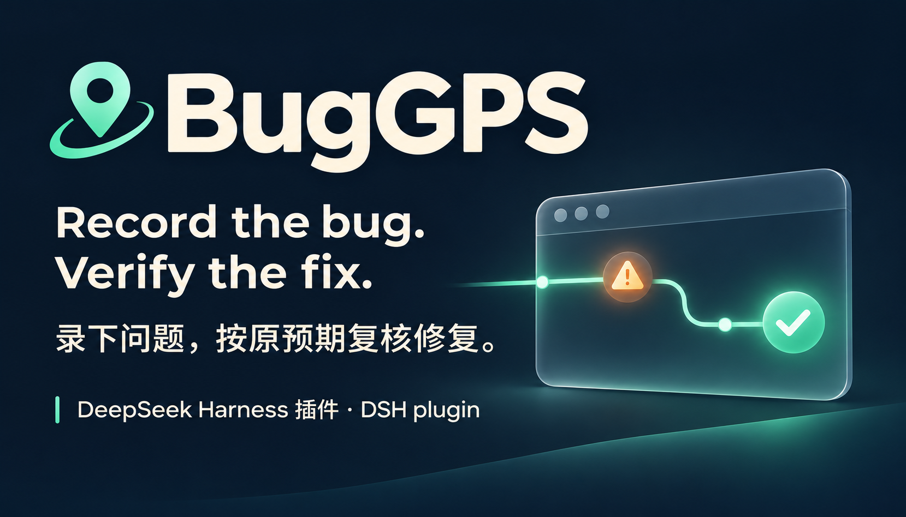
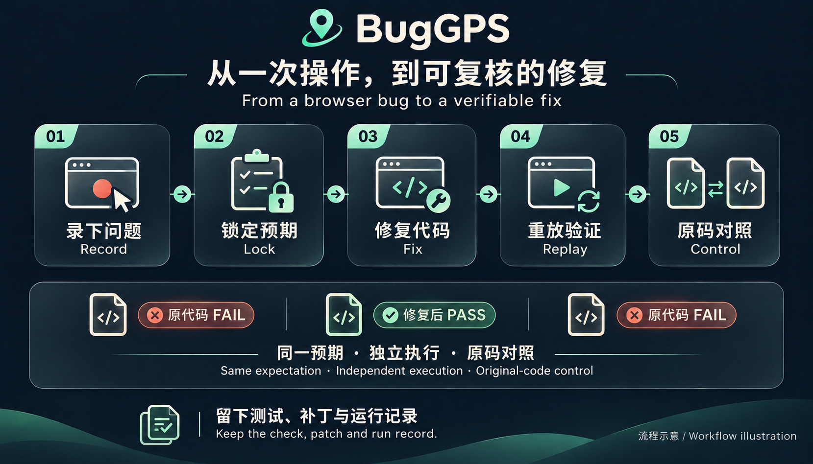

[](https://github.com/lijiaqi-AI-Product-Manager/dsh-bug-gps/releases/latest) [](https://www.npmjs.com/package/dsh-bug-gps) [](https://github.com/lijiaqi-AI-Product-Manager/dsh-bug-gps/actions/workflows/test.yml) [](https://github.com/lijiaqi-AI-Product-Manager/dsh-bug-gps/blob/main/docs/installation.md) [](https://github.com/lijiaqi-AI-Product-Manager/dsh-bug-gps/blob/main/docs/host-compatibility.md) [](https://github.com/lijiaqi-AI-Product-Manager/dsh-bug-gps/blob/main/LICENSE)

[安装 / Install](../installation.md) · [演示 / Demo](../media/buggps-demo.gif) · [运行依据 / Evidence](https://github.com/lijiaqi-AI-Product-Manager/dsh-bug-gps/issues/4)

# BugGPS · dsh-bug-gps

[简体中文](../../README.md) · [English](README.en.md) · [日本語](README.ja.md) · [한국어](README.ko.md) · [Deutsch](README.de.md) · [Français](README.fr.md) · [Español](README.es.md) · [Português (Brasil)](README.pt-BR.md)



**문제를 기록하고, 처음 정한 기대대로 고쳐졌는지 확인하세요.**

BugGPS는 DeepSeek Harness(DSH) 플러그인입니다. 이미 발견한 브라우저 문제의 동작과 기대 결과를 기록하고 반복 가능한 실패를 고정합니다. 수정 후에도 같은 검사와 독립된 기준 코드로 결과를 확인합니다.

> npm에 공개된 **1.0.0**을 설치합니다. 확인한 환경은 Windows의 DSH **0.2.1-rc.5**, `headless` / `web`입니다. 고정 Git 및 Release 설치 방법은 [설치 안내](../installation.md)를 참고하세요.

```bash
dsh plugin --profile web add dsh-bug-gps@1.0.0
dsh --profile web --dump-config
```

예시는 `web`입니다. 헤드리스 환경에서는 두 명령 모두 `headless`로 바꾸세요. 설정 레이어를 확인하고 해당 인스턴스를 재시작한 다음, 대상 Git 프로젝트에서 `buggps_status`를 호출하세요. 데스크톱은 별도 검증이 필요합니다.

[설치 및 제거(중국어·영어)](../installation.md) · [과거 검증 기록(고정 소스)](../verification/1.0.0/README.md). 각 기록은 해당 소스와 범위를 명시하며, 현재 검증 상태는 배포 체크리스트에서 확인합니다.

업그레이드 후에는 이전 브라우저 기록을 다시 만드세요. 잠글 때 기록한 텍스트, 입력값과 표시 상태를 확인합니다. 프레임이나 다른 탭의 작업이 있으면 미완료 기록으로 처리합니다.


데모는 의도적으로 결함을 넣은 예제를 스크립트로 조작하고 준비된 변경을 적용합니다. 화면과 도구 출력은 실제 실행 결과지만 주요 프레임을 편집했으므로 영상 길이는 작업 시간이 아닙니다. 결과 카드, 커서와 자막은 연출용 표시입니다.

## 내장 예제 실행

Node.js ≥20, Git, 설치된 Microsoft Edge 또는 Google Chrome이 필요합니다. 기록된 Windows 검증은 Node 24.22.0과 Edge 156을 사용했습니다. 모든 브라우저와 운영체제의 지원을 뜻하지는 않습니다.

```bash
git clone https://github.com/lijiaqi-AI-Product-Manager/dsh-bug-gps.git
cd dsh-bug-gps
git checkout --detach c48aa094b6b32731d517fb0026cceccdae60e117
npm ci
node bin/buggps.js demo ../buggps-demo
node bin/buggps.js doctor --repo ../buggps-demo
```

`demo`는 별도 Git 저장소를 만들고 다음 단계를 출력합니다. 개발 서버를 시작하고 DSH에서 프로젝트를 연 뒤 문제와 기대 결과를 기록하세요. `doctor`는 실행 환경, 브라우저, 명령, 설정과 포트를 확인합니다. 기존 초안은 다시 녹화하지 않고 고정할 수 있습니다.

## DSH에서 플러그인 로드

`dsh plugin`으로 로드하려면 PATH에 **pnpm ≥10**도 필요합니다.

```bash
dsh plugin --profile PROFILE add "/absolute/path/to/dsh-bug-gps"
dsh --profile PROFILE --dump-config
```

`PROFILE`을 실제 사용하는 프로필로, 경로를 소스의 절대 경로로 바꾸세요. 해당 DSH 인스턴스를 다시 시작하고 대상 프로젝트에서 `buggps_status`를 호출하세요. 설정 항목이 존재하는 것만으로 도구가 로드되었다고 볼 수 없습니다.

데스크톱과 CLI는 서로 다른 프로필을 사용할 수 있습니다. `web`에 설치한 결과는 데스크톱 설치를 확인해 주지 않습니다. 데스크톱에 포함된 DSH 버전과 실제 프로필을 확인한 후 앱의 플러그인 관리 기능을 사용하세요. 공식 rc.5 CLI 흐름은 검증했지만 데스크톱 설치 경로의 별도 검증은 아직 완료되지 않았습니다.

## 작동 흐름

1. **기록:** 동작, 브라우저 설정과 명시적인 기대 결과를 저장합니다. 체크포인트는 중간 상태를, 핵심 단계는 축약 시 남길 동작을 고정합니다.
2. **고정:** 저장한 `serve` 명령으로 앱을 시작하고 동일한 실패가 3회(기본값) 재현되는지 확인합니다.
3. **수정:** DSH가 기존 설정을 사용해 앱 소스를 수정합니다.
4. **검증:** 원래 조건으로 전체 기록을 3회(기본값) 재생합니다. 독립된 기준 코드에서도 원래 실패가 재현되어야 `VERIFIED`가 됩니다.

## 결과 읽기

| 판정 | 의미 |
|---|---|
| `VERIFIED` | 기록된 검사를 통과하고 새 기준 코드 대조에서도 원래 실패가 재현되었습니다. |
| `PASSED_UNBOUND` | 외부 서버의 검사는 통과했지만 실행 코드와 패치를 연결할 수 없습니다. |
| `NEEDS_REVIEW` | 비활성화된 동작, 부재만 확인하는 조건, 위치 지정 후보나 검사기 변경, 기준 코드 대조 실패 등으로 검토가 필요합니다. |
| `STILL_FAILING / DIFFERENT_FAILURE` | 원래 실패가 남아 있거나 다른 증상·체크포인트에서 실패했습니다. |
| `TEST_INVALID / ENV_BLOCKED` | 실행할 수 없는 검사 정의 또는 막힌 환경입니다. 문제 재현 성공이 아닙니다. |
| `FLAKY / STALE / CASE_TAMPERED` | 실행 결과 불일치, 검증 중 코드 변경 또는 고정된 증거 변경을 발견했습니다. |
| `NO_CODE_CHANGE` | 고정 이후 코드가 바뀌지 않았습니다. 수정 요청이면 수정과 재검증을 계속하고, 검증만 요청한 경우 변경 없음을 보고합니다. |
| `BUDGET_EXHAUSTED / ABORTED` | 예산 소진 또는 작업 취소로 증거가 완성되지 않았습니다. |

`buggps_status`는 완료 시각을 기준으로 가장 최근의 유효한 실행을 표시합니다. 과거 결과는 코드, 사례, 고정 정보와 검사기가 일치할 때만 현재에도 적용됩니다. 불일치 이유는 `not_current_reasons`에 표시됩니다. `NO_CODE_CHANGE`는 코드가 바뀌지 않았다는 판정이며 수정 성공을 뜻하지 않습니다.

도구 텍스트 미리보기는 최대 12,000자이며 판정, 증거 참조와 다음 작업을 먼저 표시합니다. `output_preview: abbreviated`가 나타나면 참조된 초안, 사례, 실행 기록이나 패치를 읽으세요. 전체 구조화 결과와 검사 조건은 바뀌지 않습니다. 생략된 텍스트로 테스트를 재구성하거나 패치를 적용하지 마세요.

## 범위와 제한

- 검증 결과는 기록한 시나리오에만 적용됩니다. 다른 버그가 없음을 증명하지 않습니다.
- 매번 초기화할 수 있는 프런트엔드 상태가 대상입니다. 측정 전에 한 차례 예비 재생하므로 서버 데이터를 변경하는 동작은 검증 범위 밖입니다.
- 최종 조건은 기본 1,000 ms 동안 목표 간격 50 ms로 검사합니다. 표본 사이와 관찰 창 이후의 변화는 포함하지 않습니다.
- 축약은 예산 안에서 확인한 더 짧은 경로입니다. 최종 판정은 전체 기록을 기준으로 하며 전역 최단 경로나 인과관계를 보장하지 않습니다.
- 스냅샷은 Git을 따르며 무시된 의존성과 설정을 포함하지 않습니다. 기준 코드의 공유 의존성과 환경 입력은 별도로 기록합니다. worktree는 보안 샌드박스가 아닙니다.
- 민감해 보이는 입력은 환경 변수 참조로 저장하지만 탐지가 완전하지 않습니다. 공유 전에 산출물을 확인하세요.
- 정의와 기록의 일관성을 확인합니다. shell 보호는 가능한 범위의 조치이며 해시만으로 위조를 방지할 수는 없습니다.

[설정·전체 판정·상세 제한](../../README.md)

## 증거와 피드백

테스트, 설치 패키지 검사와 고정된 12개 회귀 사례는 별도로 기록됩니다. 과거 사례는 구현 개선에 사용된 확장 회귀 세트이며 미공개 평가 세트가 아닙니다. 실패도 분모에 남깁니다.

[사례 가이드](../../bench/RECORDING-GUIDE.md) · [실행 기록](../../bench/results) · [브라우저 회귀 테스트](../../test/counterexamples.test.js) · [문제 신고](https://github.com/lijiaqi-AI-Product-Manager/dsh-bug-gps/issues/new)

DSH 버전, 운영체제, 기대 동작, 정확한 판정과 안전하게 공유할 재현 절차를 포함하세요. 자격 증명과 비공개 데이터는 제거하세요.

수정을 확인하는 데 도움이 되었다면 Star로 알려 주세요.

[호스트 의존성과 패키지 호환성 검사](../host-compatibility.md)

MIT · [LICENSE](../../LICENSE)


[외부 ChartDB 수정 사례 재검증](../../bench/repairs/chartdb-dbml-index/README.md) · [DSH rc.5](../../bench/results/account-project-chartdb-dbml-index-2026-11-03.json) · [ChartDB 검증 자료: AGPLv3](../../bench/repairs/chartdb-dbml-index/LICENSE)
